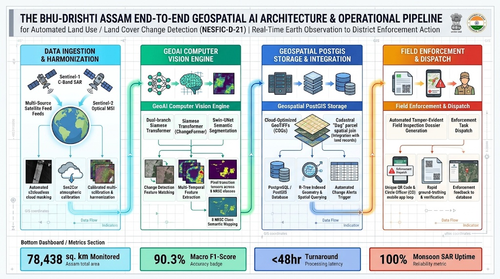
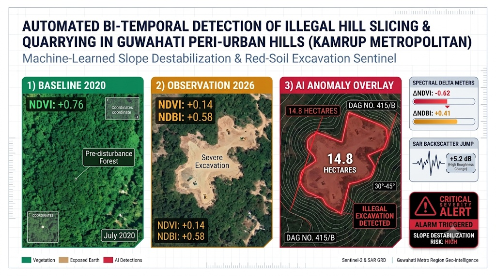
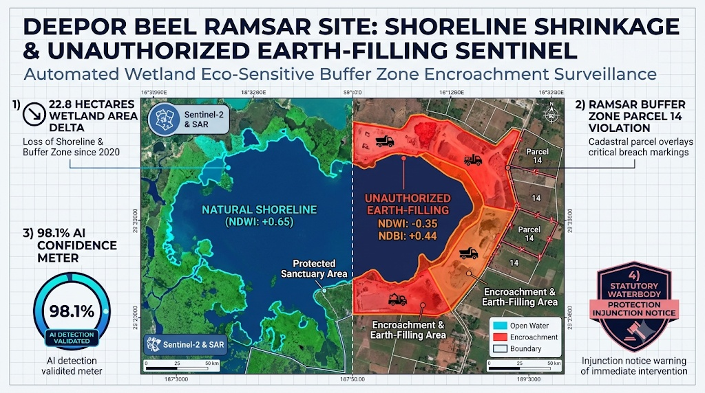
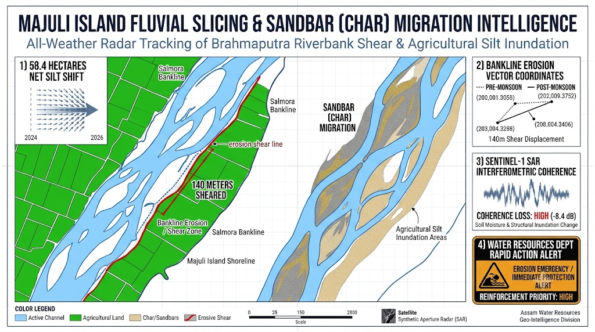

# Bhu-Drishti Assam (ভূ-দৃষ্টি অসম) — Assam GeoINT Sentinel

[](https://startup.assam.gov.in/nesfic26/problem-statements/nesfic-d-21)
[](https://opensource.org/licenses/MIT)
[](https://vitejs.dev/)
[](https://react.dev/)
[](https://tailwindcss.com/)

**AI-Based Automated Land Use / Land Cover (LULC) Change Detection & Encroachment Monitoring Platform**  
*Developed for North East Seva First Innovation Challenge (NESFIC 2026) — Government of Assam, Department of Science & Technology / Assam State Space Application Centre (ASSAC).*

---

## 🌟 Key Features

1. **Bi-Temporal Satellite Swipe Studio:** Compare baseline historical satellite layers (2020) with active surveillance (2026) across critical Assam hotspots (Guwahati Hills, Deepor Beel, Majuli Island, Kaziranga Buffer, Dibrugarh).
2. **Multi-Sensor Fusion (Optical + SAR):** Integrated Sentinel-2 optical imagery with all-weather Sentinel-1 C-band Synthetic Aperture Radar (SAR) backscatter to penetrate heavy monsoon cloud cover.
3. **Automated Anomaly Detection & Cadastral Join:** Instant classification of illegal hill slicing, wetland earth filling, and fluvial bankline erosion with automated spatial join to Assam Dharitree Revenue Cadastral plots (Dag No., Patta Type, Village, Circle).
4. **Statutory Legal Dossier Generation:** Generates tamper-evident inspection notices with GPS coordinates, boundary polygon coordinates, area calculation in Bighas/Kothas, and QR verification codes for Revenue Circle Officers and DFOs.
5. **Interactive Model Playground:** Test and evaluate ChangeFormer and Swin-UNet architectures with custom confidence thresholds and transition matrices.
6. **10 High-Impact Technological Infographics:** Pre-rendered 16:9 widescreen technological architectural framework infographics covering system architecture, case studies, radar penetration, phenology filtering, and validation matrices.

---

## 🏛️ System Architecture



The platform implements an automated closed-loop Geospatial AI pipeline:
- **Ingestion & Calibration:** Sentinel-1 SAR (RTC/GRD) & Sentinel-2 MSI via Sen2Cor radiometric calibration.
- **Deep Learning Core:** Dual-branch Siamese Transformer (`ChangeFormer-v2`) with Swin-UNet semantic segmentation.
- **Phenological Filter:** Multi-temporal Harmonic NDVI curve suppression to distinguish seasonal cropping from illegal conversions.
- **Revenue Integration:** PostGIS spatial join against Assam Dharitree Cadastral Shapefiles.
- **Enforcement Dispatch:** Automated statutory eviction/inspection notice generation.

---

## 📊 Proof of Work & Hotspot Case Studies

### Guwahati Urban Fringe Hill Slicing


### Deepor Beel Ramsar Wetland Encroachment


### Majuli Island Fluvial Erosion & Char Migration


---

## 🚀 Quickstart

### Prerequisites
- Node.js (v18+)
- npm or pnpm

### Installation
```bash
git clone https://github.com/RonHatibaruah/assam-geoint-sentinel.git
cd assam-geoint-sentinel
npm install
```

### Run Development Server
```bash
npm run dev
```
Open [http://localhost:5173](http://localhost:5173) in your browser.

### Production Build
```bash
npm run build
```

---

## 📄 Proposal Submission

The full 12-section grant proposal adhering strictly to the $\le 500$ words per section requirement for NESFIC-D-21 is available in [PROPOSAL.md](PROPOSAL.md) and inside the web application's **Proposal Submission** tab.

---

## 📜 License
MIT License. Developed for the Government of Assam, ASSAC & Department of Science & Technology.
